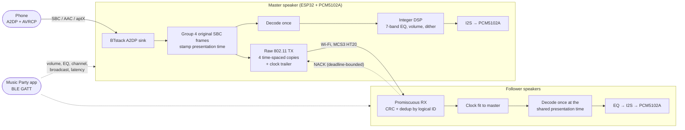

# ESP32 Wi-Fi Music Party

**One phone. Many cheap speakers. One beat.**

Wi-Fi Music Party turns plain ESP32 boards with a PCM5102A DAC into Bluetooth speakers that can
link up the way a JBL PartyBoost or Sony Auracast speaker does: play solo by default, press
"broadcast", and every speaker in the room starts playing the same song on the same timeline.

No PSRAM, no extra radio, no router. The speaker that holds the phone's music becomes the
party master and throws the audio into the air over raw Wi-Fi; every other speaker catches it,
lines it up against the master's clock and plays it at the same moment.

> Status: active development. It plays, it parties, and the numbers below are real bench
> measurements, but there is no one-hour soak, acoustic sync measurement or large-crowd test yet.
> See [Status and known limits](#status-and-known-limits).

---

## Two modes, one button

|  | **Solo** (every power-on) | **Party** (broadcast on) |
|---|---|---|
| Wi-Fi | completely de-initialised | on, raw broadcast, no access point or association |
| Codecs offered to the phone | SBC, AAC, aptX, aptX HD | SBC (AAC-LC opt-in) |
| Who plays | this speaker | the master and every speaker that joins |
| Timeline | local | one master-owned presentation timeline (300 ms default) |
| Stereo | full stereo | full stereo, or a left/right pair when exactly two speakers are in the party |

Switching broadcast on while the phone streams aptX does a **codec handover**: the speaker
releases the stream, offers only party codecs, reconnects with SBC in about a second and, if
the phone was playing, sends AVRCP Play so the music comes back by itself. Switching broadcast
off on the master keeps the music going solo with no gap; followers fade out.

## How the party works



**Life of an audio group**

```text
phone ──SBC──▶ master: [f1 f2 f3 f4]  4 original codec frames = 11.6 ms at 44.1 kHz
                          │  presentation time = master clock + 300 ms
                          ▼
air:      copy#1 ──33ms── copy#2 ──33ms── copy#3 ──33ms── copy#4     same logical ID
                          ▼
follower: first good copy wins, the rest are dropped as duplicates
          missing? ask the master again (NACK) while the deadline still allows it
          still missing at play time? conceal: continue, fade, crossfade back
                          ▼
every speaker: decode once ─▶ play at the same presentation time
```

The building blocks:

- **Original bytes, never re-encoded.** The master forwards the phone's own SBC frames, four per
  group, with length prefixes and real sample counts. Group duration comes from the actual
  samples per frame and sampling rate.
- **Copies instead of FEC.** Each group goes out four times, spaced apart in time, under one
  logical ID. Receivers check the CRC, deduplicate and decode once. Forward error correction was
  tried and removed; lost groups are repaired by deadline-bounded NACK replay.
- **One timeline, owned by the master.** Each copy carries a 16-byte clock trailer (send stamp,
  time to the next copy, TX serial, master volume). Followers fit the master's clock from the
  least-delayed copy in each 100 ms window and steer their audio PLL in small ppm steps. Latency
  changes are one common step on the master's timeline, never per-speaker growth.
- **Leadership follows the music.** The speaker carrying the phone's audio is master. A
  follower refuses its own phone's stream start while another board leads, and parks its idle
  phone link in sniff mode so the radio stays free to listen.
- **The channel finds itself.** Idle speakers hop between channels 1, 6 and 11, measuring
  other Wi-Fi traffic and listening for a party; a new master moves to the least-used channel
  and receivers lock on to wherever they hear it.
- **The radio is shared.** Wi-Fi, Classic Bluetooth and BLE share one 2.4 GHz radio. Followers
  install a Wi-Fi-heavy coexistence table; BLE connection intervals relax while the app is idle.

## Features

- **Bluetooth A2DP sink** on [BTstack](https://github.com/bluekitchen/btstack) (not Bluedroid):
  SBC, AAC-LC, aptX and aptX HD in solo; SBC (plus AAC-LC on request) in a party.
- **AVRCP controller and target**: absolute volume synced both ways, auto-resume after a
  codec handover.
- **Party broadcast** over raw Wi-Fi to any number of followers that all play on the master's
  timeline. Late joiners slot in without restarting the source.
- **Stereo pair**: set one speaker left and one right; it applies when the party is exactly
  two speakers, otherwise everyone plays full stereo.
- **7-band EQ** in integer arithmetic only: 63 Hz low shelf, 160 / 400 / 1k / 2.5k / 6.3k Hz
  peaking (Q 1.1), 16 kHz high shelf, ±12 dB. Q28 coefficient tables for 16 / 32 / 44.1 / 48 kHz
  are generated by [`tools/gen_eq_tables.py`](tools/gen_eq_tables.py); the biquads use a
  split accumulator with error feedback (about 54 cycles per band per sample).
- **Clean output path**: 24-bit internal PCM, audio-taper volume ((p/100)², 100 % is bit-exact
  unity), noise-shaped TPDF dither to 16-bit, 32-bit I2S for aptX HD.
- **BLE control service** documented in [`docs/ble-control-protocol.md`](docs/ble-control-protocol.md):
  volume, EQ, speaker channel, broadcast on/off, party codec, latency and a 20-byte live status.
- **Flutter companion app** in [`app/wmp_party`](app/wmp_party): finds nearby speakers and controls volume, EQ
  presets, stereo channel, broadcast and party codec. Runs in demo mode without hardware.

## Hardware

| Part | Notes |
|---|---|
| ESP32 (original, dual core, 240 MHz) | no PSRAM needed; 4 MB flash layout |
| PCM5102A I2S DAC | one per speaker |
| Amplifier + driver | whatever you have |

| PCM5102A pin | ESP32 GPIO |
|---|---|
| LRCK / WS | **25** |
| DIN (data) | **26** |
| BCK | **27** |

Each speaker shows up twice on your phone: `WMP-Sink-XXXX` for music (Classic Bluetooth) and
`WMP-Control-XXXX` for the app (BLE), where `XXXX` is the end of its MAC address.

## Quick start

### 1. Fetch the pinned dependencies

The SDK, Bluetooth host and decoders are not vendored. Clone them into `third_party/` at the
exact commits listed in [`third_party/README.md`](third_party/README.md):

| Dependency | Pin |
|---|---|
| ESP-IDF | `v6.1` · `fff9895c82d744c7237be8847347bdd1b07c6643` |
| BTstack | `v1.8.3` · `51e11ce3692abfe31b4ee3d66cffdeb1ae1626f2` |
| esp32-hifi-a2dp-sink (AAC + aptX decoders) | `7dcb71a0c3ffea973322fcec1f8f46abecd6b079` |

### 2. Build (PowerShell)

```powershell
python tools/build_app.py
```

The build freezes a copy of every source file it uses, refuses to run if a dependency moved or
was modified, and writes everything to `build/app-<timestamp>/`: `app.json` (source hashes,
pins, image hashes) and the images under `idf-build/`. It expects the ESP-IDF v6.1 tools
(Python env, xtensa-esp-elf, CMake, Ninja, ccache) installed in the default `.espressif`
folder; the exact tool paths are at the top of `build_app.py`.

### 3. Flash (921600 baud)

```powershell
python -m esptool --chip esp32 -p COM6 -b 921600 --before default-reset --after hard-reset write-flash --flash-mode dio --flash-freq 40m --flash-size 4MB 0x1000 build/app-<timestamp>/idf-build/bootloader/bootloader.bin 0x8000 build/app-<timestamp>/idf-build/partition_table/partition-table.bin 0x10000 build/app-<timestamp>/idf-build/wmp_audio.bin
```

The serial console runs at **115200**. On the author's bench, `tools/install_app.py` and
`tools/flash_esptool.py` wrap this with board identity checks, exact readback and receipts;
they rely on local hardware records that are not part of this repository.

### 4. Throw a party

1. Power up two or more speakers. Each one starts in solo mode.
2. Pair your phone with one of them and play music.
3. Turn broadcast on: in the app, or over serial with `BROADCAST 1`. Do the same on the others.
4. The speaker with your music becomes the master; the others join within a few seconds.
5. Optional: `SPEAKER 1` / `SPEAKER 2` (left / right) on a two-speaker party.

### Host tests

```powershell
python tests/test_protocol.py
python -m unittest discover -s tests -p test_handover_ready.py
```

`test_protocol.py` compiles the portable C in `protocol/` with clang and drives it from Python
(wire format, grouping, deduplication, queues, playout, NACK, beacon clock).

## Repository map

| Path | What lives there |
|---|---|
| [`firmware/app`](firmware/app) | ESP-IDF application: Bluetooth (A2DP/AVRCP/BLE), radio, audio pipeline, GATT, settings |
| [`firmware/components`](firmware/components) | BTstack config, codec glue (AAC, aptX), protocol component wrapper |
| [`protocol`](protocol) | Portable C: wire format, audio groups, dedup, payload pools, playout, NACK, beacon clock |
| [`tests`](tests) | Host tests for the protocol and the bench tooling |
| [`tools`](tools) | Build, flash, capture, analysis and A/B experiment scripts |
| [`docs`](docs) | BLE control protocol |
| [`research`](research) | Design notes and findings from each investigation |
| [`app/wmp_party`](app/wmp_party) | Flutter (Android) companion app |
| [`CURRENT_STATUS.md`](CURRENT_STATUS.md) | Dated log of measurements and fixes |
| [`ACCEPTANCE.md`](ACCEPTANCE.md) | Acceptance gates the project is working towards |

## Measured so far

From [`CURRENT_STATUS.md`](CURRENT_STATUS.md), on three ESP32 boards with a real phone streaming:

- **Three-speaker party, SBC 44.1 kHz**: 60 s windows with 0 concealed groups on the master and
  both followers, with and without a non-flat EQ. Followers joining mid-song show 4-16
  concealed groups while they lock on.
- **PHY rate choice**: a 19-rate sweep picked MCS3 HT20. At MCS7, about 76 % of copies arrived
  and CRC errors were high; at MCS3, about 87 % arrived with zero concealment in both passes.
- **Timeline**: moving from 200 ms to a 300 ms master timeline removed recurring concealment
  bursts caused by bursty phone input (212 s, 0 concealed, 0 late).
- **Handover**: after switching broadcast on during playback, music resumed by itself about
  4 s later via AVRCP Play.
- **Solo aptX 48 kHz**: 60 s with one concealed group at start-up; about 6 ms of decode per call.
- **Audio clock**: an APLL steering bug that made the DAC sound grainy was fixed (only the
  changed sigma-delta bytes are written, at most every 100 ms); confirmed clean by ear.

## Status and known limits

Honest list, in no particular order:

- No **one-hour** continuous soak has passed yet.
- **Phone-to-speaker latency** has not been measured. The 300 ms party timeline sits on top of
  whatever the phone buffers.
- Synchronisation is measured with **digital counters and clock-fit error**, not with a
  microphone. No acoustic sync measurement exists.
- Tested with up to **three** speakers. Many-speaker behaviour is a design goal, not a result.
- **Master RAM is tight** while broadcasting (about 18-26 KB free heap).
- **AAC-LC in a party** is implemented but not yet tested on hardware.
- **Party volume** (followers follow the master's volume) is implemented but not yet confirmed
  by ear or telemetry.
- Party sync has not been re-checked since the slower 100 ms APLL steering change.
- **LDAC** is not supported.
- The bench tools assume the author's lab (specific COM ports, phones and local hardware
  records). The firmware itself has no such assumptions.

## Things this project is not

- **Not Auracast / LE Audio.** Auracast inspired the user experience and some design ideas,
  but this is a custom Wi-Fi transport. It does not interoperate with Auracast or LE Audio
  devices.
- **Not ESP-NOW.** The transport is its own framing on raw 802.11 frames.
- **Not a re-encoder.** Party audio is the phone's original codec frames, decoded once on each
  speaker.

## Credits

Built on [ESP-IDF](https://github.com/espressif/esp-idf) by Espressif and
[BTstack](https://github.com/bluekitchen/btstack) by BlueKitchen. AAC decoding uses the Helix
AAC decoder (RealNetworks RPSL) and aptX uses libfreeaptx
(LGPL-2.1-or-later), both taken from
[esp32-hifi-a2dp-sink](https://github.com/WillyBilly06/esp32-hifi-a2dp-sink). Each keeps its
own licence.
